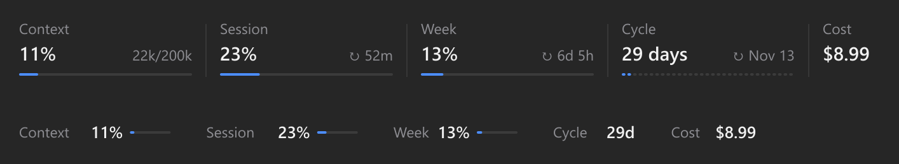

# usage-strip

A minimal usage strip above the Claude Code prompt. See how much context you've used, how close you are to your 5-hour and weekly limits, and how many days are left in your billing cycle, without opening anything.



- **Context**: percent used and tokens (`22k/200k`). The number that moves on every message.
- **Session (5h)** and **Week (7d)**: percent used and time until each resets.
- **Cycle**: days left until your subscription renews, one segment per day. Optional (see below).
- **Cost**: shown only when there is a cost to show (it reads $0 on a subscription).

Bars turn **amber at 70%** and **red at 85%**. A toast warns you once when the 5-hour limit hits 80% and 95%, the weekly limit 90%, and context 85%.

## Install

In a Claude Code terminal session:

```
/plugin install usage-strip --marketplace DevQuiles/usage-strip
```

Answer `y` to add the marketplace, then pick a scope. The strip appears above the prompt after your first message, in the terminal and in the desktop app.

## Use it

Hover the strip to reveal two controls in its corner:

- **Hide / Show** folds the strip into one thin line and back. It remembers your choice across sessions.
- **Settings** sets the day of the month your subscription renews. Claude Code doesn't report the renewal date, so this is the one thing you set by hand. Choose **Off** to hide the cycle.

In the terminal the controls are always visible at the end of the row.

## Requirements

- A Claude Code build with mods (function hooks). Built and tested on **2.1.295** in the desktop app on Windows.
- A Claude subscription for the 5-hour and weekly limits. On an API key those columns don't appear and only context (and cost) shows.

> The mods API is in early access and may change between Claude Code releases. If the strip stops drawing after an update, open an issue.

## Development

```
claude --plugin-dir ./usage-strip
```

Claude Code writes the API typings to `.claude-plugin/types/` the first time it loads the mod. After that:

```
claude plugin validate .
claude plugin test .
tsc -p .
```

## License

MIT
